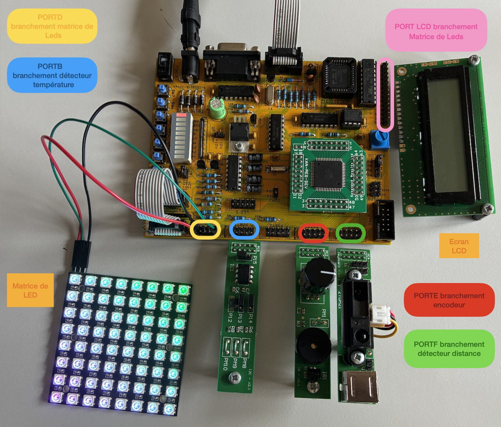
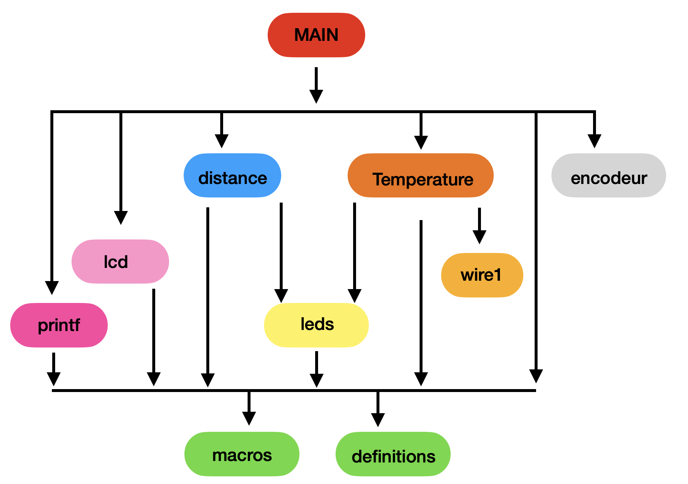

# MCU Assembly Project

Interactive sensor interface written in AVR assembly for the ATmega128 (STK-300 board). EPFL MICRO-210 course project (group 063).

## Features
- **Menu** on a 2x16 LCD, navigated with a rotary encoder (turn to select, press to confirm)
- **Distance mode:** distance sensor read through an ADC interrupt, shown in cm on the LCD and as a blue-to-red gradient on a WS2812b LED matrix
- **Temperature mode:** Dallas 1-Wire sensor, shown in °C on the LCD and as a color on the LED matrix
- **Ambiance mode:** ambient music played on a buzzer, toggled with buttons 0 and 1

## Code structure
- `Main.asm`: main loop, menu and mode logic
- `distance.asm`, `temperature.asm`, `wire1.asm`: sensors
- `leds.asm`, `lcd.asm`, `printf.asm`, `encoder.asm`, `sound.asm`: peripherals
- `macros.asm`, `definitions.asm`: provided constants and macros

## Build
Compile with Atmel Studio, then flash the ATmega128 with `avrisp`.

## Documentation
See `Rapport_MCU.pdf` for the full report (in French) and `Présentation_projet.mp4` for a demo.
